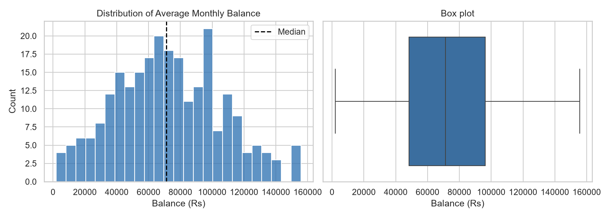
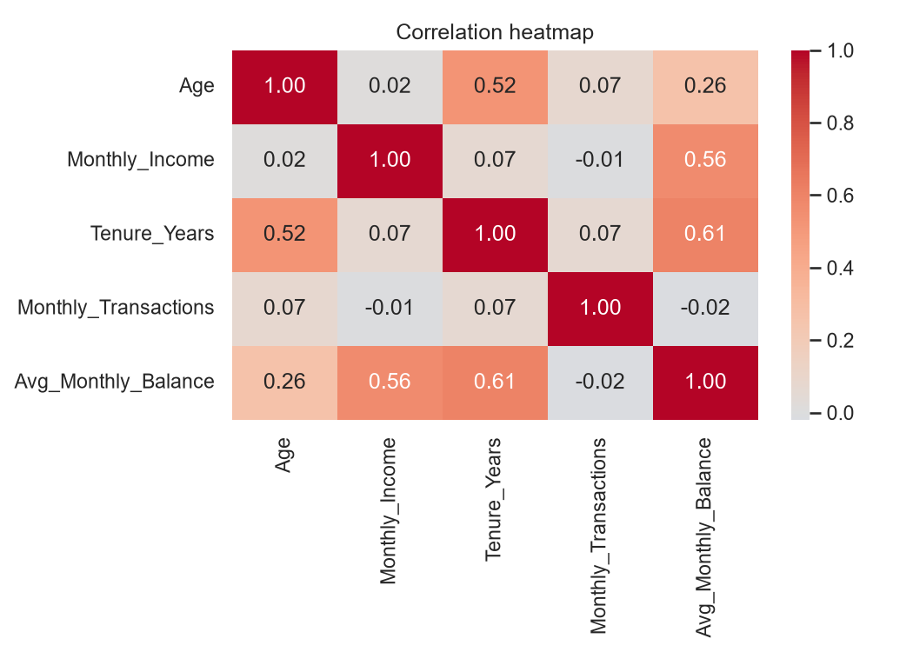
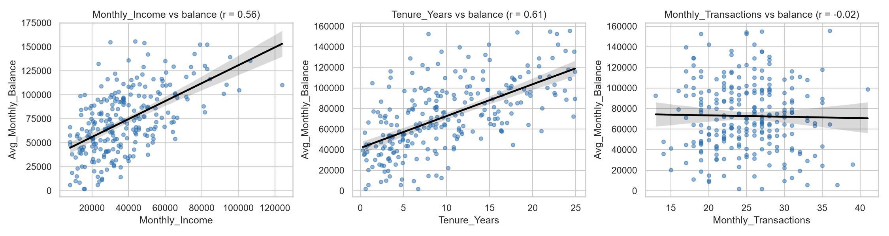
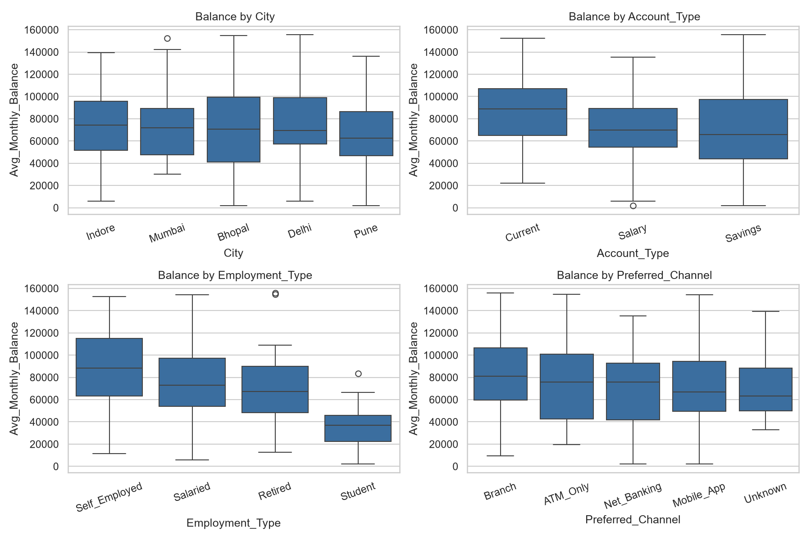
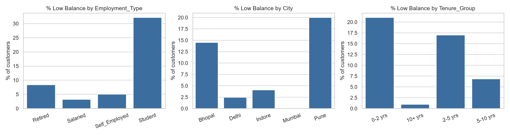

# Bank Customers Data Analysis

Understanding Customer Balances at a Retail Bank.

## Business Problem 
A retail bank's branch and digital teams want to know which customers keep healthy balances and which are slipping. The Customer Insights team needs this analysis to decide whom to target with savings offers and whom to contact before they become inactive. The outcome to study is Avg_Monthly_Balance, the average amount a customer keeps in their account each month.

## Questions answered
1. What does Avg_Monthly_Balance look like overall?
2. Do Monthly_Income and Tenure_Years affect Avg_Monthly_Balance?
3. Does Avg_Monthly_Balance differ by City, Account_Type,Employment_Type or Preferred_Channel?   
4. Which records need attention?

## Dataset
` Data/Raw Data/bank_data.csv ` - 255 rows , 11 columns (Customer_ID,City,Account_Type,Employment_Type,Preferred_Channel,Age,Monthly_Income,Tenure_Years,Monthly_Transactions,Last_Activity_Date,Avg_Monthly_Balance).

## Project Structure
```
Bank Customers Data Analysis/
├──Data/
|    ├──Raw Data/bank_data.csv
|    └──Processed Data/bank_data_clean.csv
├──Documentations/
|   ├──requirements.txt
|   ├──2026B01010297_SaurabhBansal_SRS.docx
|   └──2026B01010297_SaurabhBansal_PPT.pptx
├──Images/      (charts saved by notebook)
├──Notebooks/
|   ├──bank_data.csv
|   ├──bank_data_clean.csv
|   ├──Draft1Day3.ipynb
|   ├──Draft2Day4.ipynb
|   └──final.ipynb
└──README.md
```

## Steps Followed
1. Load and inspect data  
2. Clean data (duplicates, text, outliers, missing values)  
3. Create new columns (Income_per_Transaction,Customer_Segment        Tenure_Group)  
4. Exploratory analysis with charts  
5. Insights and recommendations

## Key Findings
1. Average balance: Rs 72,671; median Rs 71,180.
2. Income vs balance correlation = 0.56; tenure vs balance = 0.61; transactions vs balance = -0.02.
3. Highest-balance group: Self_Employed (Rs 86,872); lowest: Student (Rs 35,174).
4. Current accounts average Rs 84,972 vs Rs 70,888 for Savings.
5. 19 customers are Low Balance; 9 of them are students. Their average tenure is 4.3 years.

## Charts
 
 
 
 


## Tools
Python 3 · pandas · NumPy · matplotlib · seaborn · Jupyter Notebook · Git and GitHub · VS code

## Author
Saurabh Bansal – B.Tech 1st Year, ABES Engineering College
Addmision no. - 2026B01010297 
Branch/Section - CSE/12
Email ID - saurabh.26b01010297@abes.ac.in